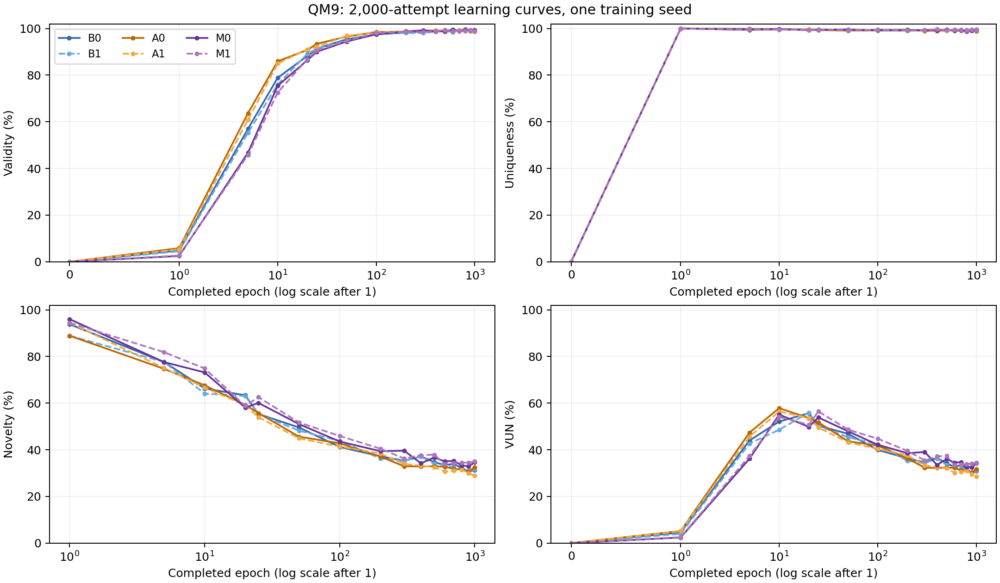
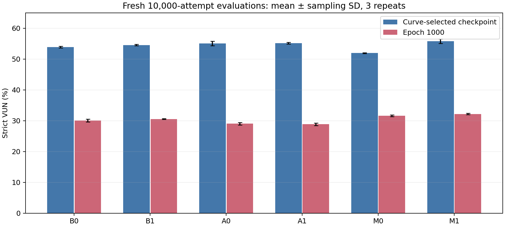

# QM9 structural-prior batch 1: results and assessment

Priority update: the user clarified that final validity and validity learning
speed are primary, with VUN as a secondary overall metric. The original
VUN-centered interpretation below is historical. Read the
[validity-first reassessment and next-batch proposal](../../qm9-batch2-validity-plan.md).
The numerical results and figures below remain applicable.

Assessed 2026-10-28. Executed source: `cd902863f32a9a42b32f75fd95b5034e5e1eb9fc`. Training seed 0; six configurations; QM9 without explicit hydrogens.

All six tasks completed 1000 epochs and 96,000 optimizer steps. CPU preparation 11846895, GPU array 11846896 and W&B sync 11846897 completed with exit 0:0. No new experiments were submitted during this assessment.

## Main finding

Longer training improves strict validity but sharply reduces novelty and VUN. Every curve-selected checkpoint is at epoch 10, 20 or 25. At epoch 1000, M1 has the highest VUN, but changing the edge prior gives only small and inconsistent gains within matched model pairs. These are screening results from one training seed.

## Fresh 10k final evaluations

Every score is a percentage. VUN is mean ± sample SD over three fresh 10,000-attempt repetitions. The selected checkpoint was chosen using the separate 2,000-attempt curve pool; the final reporting pools did not influence selection.

| Model | Validity at 1000 | Uniqueness at 1000 | Novelty at 1000 | VUN at 1000 | Selected epoch | Selected VUN |
| --- | ---: | ---: | ---: | ---: | ---: | ---: |
| B0 | 98.81 | 96.12 | 31.66 | 30.07 ± 0.45 | 20 | 53.85 ± 0.26 |
| B1 | 98.86 | 96.37 | 32.08 | 30.57 ± 0.12 | 20 | 54.51 ± 0.23 |
| A0 | 98.85 | 96.07 | 30.57 | 29.03 ± 0.41 | 10 | 55.06 ± 0.74 |
| A1 | 98.86 | 96.14 | 30.37 | 28.87 ± 0.41 | 10 | 55.13 ± 0.27 |
| M0 | 99.05 | 96.44 | 33.13 | 31.65 ± 0.27 | 10 | 51.94 ± 0.13 |
| M1 | 99.03 | 96.14 | 33.81 | 32.19 ± 0.24 | 25 | 55.79 ± 0.71 |

VUN = distinct novel strictly valid molecules / attempted molecules. Strict validity requires sanitization and connectedness, with no charge repair or largest-fragment substitution. Legacy relaxed scores are retained separately.

## Learning curves and interpretation





- B0 peaks on the 2k curve at epoch 20 (55.70% VUN), then reaches 30.85% at epoch 1000. Fresh 10k results confirm the decline: 53.85% to 30.07%.
- The same early-peak pattern holds for all six variants. Near-99% final validity is accompanied by only 30–34% novelty among unique valid molecules; 10k uniqueness remains around 96%. The dominant loss of VUN is lower novelty, rather than a collapse into a few duplicate outputs.
- This is consistent with increasing reproduction of familiar training molecules, but does not by itself prove overfitting. B0 validation edge CE at t=0.5 improves slightly from 0.5114 at epoch 20 to 0.5088 at epoch 1000. Several other validation losses improve or remain nearly flat. Novelty and distribution fit are different objectives.
- The early selected checkpoints have lower validity: B0 87.15%, B1 87.87%, A0 84.72%, A1 83.69%, M0 73.71%, M1 89.89%. Optimizing VUN therefore changes the validity/novelty tradeoff. Strict validity alone does not establish dataset-distribution fidelity, useful chemistry or scaffold diversity; those were not measured by this batch.
- The 2k and 10k scores should not be compared as equal evaluation budgets: uniqueness and VUN depend on pool size. The chart compares 2k pools throughout training; the table compares 10k pools throughout final reporting.

## Matched comparisons

Final epoch-1000 VUN differences, in percentage points:

| Comparison | Difference | Interpretation |
| --- | ---: | --- |
| B1 − B0 | +0.50 | Size-conditioned density gives a small gain |
| A1 − A0 | −0.17 | No gain from the atom-aware Chung–Lu edge prior in fixed-atom models |
| M1 − M0 | +0.54 | Small gain from the fixed-reference structural prior |
| M0 − B0 | +1.58 | Revisable-reference construction is promising, but changes conditioning and node path |
| M1 − B0 | +2.13 | Best final system result; cannot attribute the entire difference to the edge prior |

M1 also has the highest fresh VUN at its selected checkpoint (55.79%). Its selected checkpoint is epoch 25, whereas M0 selects epoch 10. The selected-checkpoint difference of 3.85 points combines model and checkpoint-age differences; it is not a fixed-epoch estimate of the edge prior effect. A1 and A0 selected scores are essentially tied (55.13% versus 55.06%).

All six use one training seed. The reported SDs measure repeated-sampling variability only. These results do not establish significance or robustness across training runs.

## Composition and structural checks

- A0/A1 preserve atom labels and composition exactly across all audited curve and final pools.
- M0 changes approximately 45.01% of atom labels and 90.43% of compositions at epoch 1000; M1 changes approximately 44.97% of atom labels and 90.76% of compositions. Composition change counts refer to represented heavy-atom counts, before any correction. The M construction therefore does revise composition, rather than merely permuting atom identities.
- Final A0/A1 uniqueness is about 96.1%, close to B0. Empirical fixed compositions did not cause a large uniqueness collapse in this screen. Their final novelty is slightly lower than B0, while their early selected novelty is higher; the effect depends on training stage.
- Identical training statistics/reference hashes, matched graph-size draws and matched A/M reference-composition draws were verified. Final model-weight hashes equal the curve hashes at the reported checkpoint epochs. All V/U/N/VUN numerators, denominators and aggregate SDs were independently recomputed.

## Cost and storage

| Model | Training-only hours | Allocated A100 hours | Mean epoch seconds | 10k generation seconds at epoch 1000 |
| --- | ---: | ---: | ---: | ---: |
| B0 | 5.33 | 6.29 | 19.20 | 306.7 |
| B1 | 5.44 | 6.41 | 19.60 | 306.5 |
| A0 | 5.27 | 6.22 | 18.96 | 311.3 |
| A1 | 5.15 | 6.10 | 18.54 | 299.1 |
| M0 | 5.44 | 6.39 | 19.57 | 308.1 |
| M1 | 5.49 | 6.46 | 19.78 | 305.8 |

Total allocated GPU time: **37.85 A100-hours**, or **38.37 including the 0.516-hour pilot**. Remaining within the original 50-hour envelope: **11.63 hours**. New variants have no large observed training or sampling overhead; the roughly 5% spread in epoch times cannot isolate model overhead from hardware/run variability.

Working run artifacts occupy approximately 14 GiB; selected/recovery home backups approximately 2.2 GiB. All six archived summaries exist. W&B sync logs show six successful uploads to [defog-qm9-batch1](https://wandb.ai/maxlyu254-university-of-illinois-urbana-champaign/defog-qm9-batch1).

## Recommended next decision

Under the clarified validity-first objective, prioritize B0/A0/M0/M1 replication:
A0 tests the apparent early-validity advantage, M0 the small mature-validity
advantage, and M1 the isolated reference-based edge-prior change. Compare fixed
endpoints and validity curves, with VUN at the same checkpoints. The proposed
budget-limited 100-epoch follow-up and the separate cost of 1000-epoch
confirmation are in the linked validity-first plan. No follow-up jobs were
launched by this assessment.

## Artifacts and reproduction

- `assessment.json`: audited numerical results and validation-loss records.
- `final-comparison.csv`: final and selected metrics, including all component SDs.
- `learning-curves.csv`: all six 17-point curves.
- PNG and PDF figures: learning curves and selected-versus-final VUN.
- Ignored local source metric copy: `artifacts/qm9-batch1-11846896/`.
- Full cluster runs: `/scratch/xinyan14/motiflow-experiments/qm9-batch1/batch1-ready-20261026/runs/`.
- Home backups: `/u/xinyan14/motiflow-artifacts/qm9-batch1/batch1-ready-20261026/`.

```bash
python scripts/analyze_batch1.py --input /path/to/batch-root --output /path/to/assessment --plots
```

The input needs launch/accounting records, per-run manifests/checkpoint indices, metric JSONL/summaries, and per-pool diagnostic JSON. Plotting requires matplotlib; the metric audit itself uses only the Python standard library. Raw graph binaries, checkpoints, full logs and credentials are excluded from this curated report.
